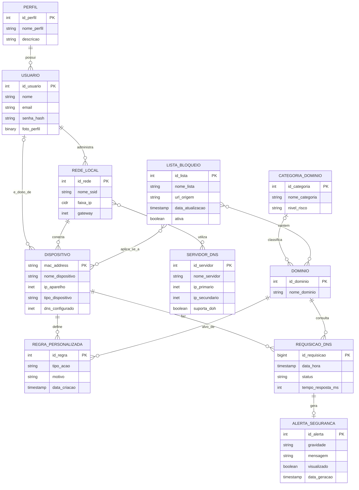
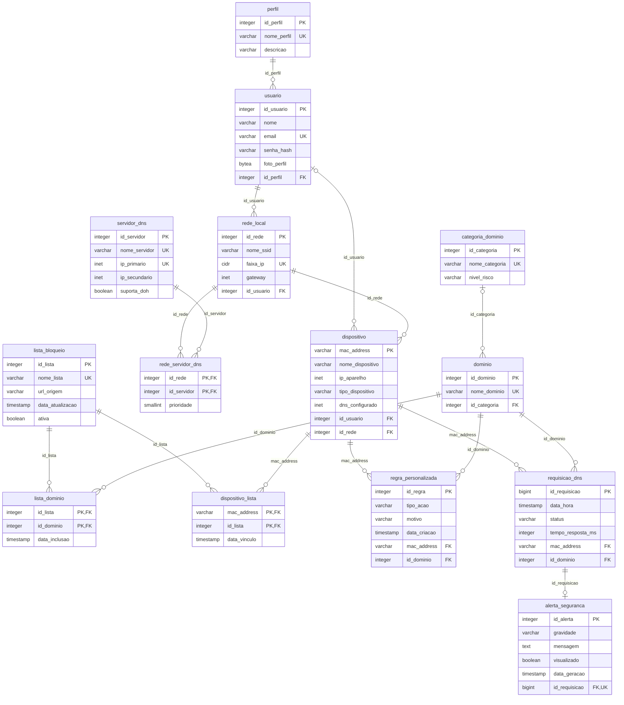
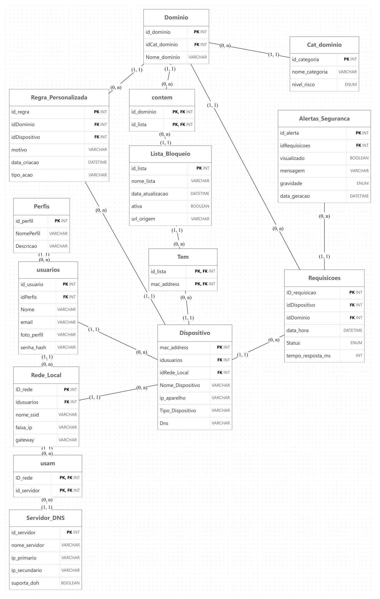

<div align="center">

**Universidade de Brasília — Instituto de Ciências Exatas**
**Departamento de Ciência da Computação — Disciplina: Banco de Dados — 2026/2**

# Sistema de Monitoramento de Rede Doméstica e Bloqueio de Anúncios via DNS

### Entrega 1 — Introdução, MER/DER, Modelo Relacional e Uso de IA

**Repositório GitHub:** <https://github.com/Geovanne-JR/Projeto-BD-2026-2>

**Integrantes:** _(preencher: Nome — Matrícula)_

**SGBD:** PostgreSQL  **Linguagem do CRUD (entrega final):** Java (JavaFX + JDBC)

</div>

---

## Sumário

1. Introdução
2. Modelo Entidade-Relacionamento (MER / DER)
3. Modelo Relacional
4. Indicação do Uso de IA

---

## 1. Introdução

### 1.1 Contextualização do problema

Uma rede doméstica atual reúne muitos aparelhos: celulares, notebooks, Smart TVs, consoles, assistentes virtuais e outros dispositivos IoT. Quase tudo o que esses aparelhos fazem na internet começa com uma **consulta DNS**, que traduz um nome de domínio (por exemplo, `www.exemplo.com.br`) em um endereço IP. Grande parte dessas consultas não parte de uma ação do usuário. Elas são feitas por **anúncios, rastreadores de telemetria e scripts de terceiros** embutidos em aplicativos e páginas web. Em alguns casos, são feitas por **malware** ou por **domínios de phishing**.

Ferramentas como o **Pi-hole** funcionam como um *DNS sinkhole*: o servidor DNS da rede recebe todas as consultas, compara cada domínio com **listas de bloqueio** e responde com um endereço nulo quando o domínio é indesejado. Assim, anúncios e rastreadores ficam bloqueados para **todos os dispositivos da rede ao mesmo tempo**, sem instalar nada em cada aparelho. Além disso, o histórico de consultas mostra **quais dispositivos acessam o quê e quando**, o que ajuda a identificar comportamentos suspeitos.

### 1.2 Objetivos do sistema

O sistema proposto organiza em um banco de dados relacional as informações necessárias para:

- **Cadastrar usuários e perfis de acesso** (administrador, responsável, membro, visitante), incluindo foto de perfil armazenada como dado binário;
- **Mapear a rede doméstica**: redes locais (SSID, faixa de IP, gateway), os servidores DNS *upstream* usados por cada rede e os dispositivos conectados, identificados pelo endereço MAC;
- **Gerenciar o bloqueio**: listas de bloqueio (públicas ou manuais), os domínios de cada lista, as categorias de domínio com nível de risco e quais listas valem para cada dispositivo;
- **Permitir exceções**: regras personalizadas que **bloqueiam** ou **liberam** um domínio específico em um dispositivo específico (por exemplo, bloquear redes sociais apenas no tablet das crianças);
- **Registrar o histórico** de requisições DNS (dispositivo, domínio, data/hora, status e tempo de resposta);
- **Gerar alertas de segurança** quando uma requisição envolve domínio de alto risco (malware, phishing etc.).

### 1.3 Escopo do banco de dados

O banco de dados cobre o **cadastro**, a **configuração do bloqueio** e o **registro histórico** do tráfego DNS da rede doméstica. O modelo tem **11 entidades** (acima do mínimo de 10 exigido) e **3 relacionamentos N:N**, que se tornam tabelas associativas no modelo relacional, totalizando **14 tabelas**.

Ficam **fora do escopo** desta etapa: a resolução DNS em si (feita pelo servidor, por exemplo o próprio Pi-hole), a captura de pacotes e a aplicação CRUD em JavaFX, que será implementada na entrega final. Também ficam para a entrega final as *views*, *procedures*, *triggers* e a carga de dados de exemplo.

O script DDL completo está em [`sql/schema.sql`](https://github.com/Geovanne-JR/Projeto-BD-2026-2/blob/main/sql/schema.sql). Todas as entidades com chave substituta usam o gerador automático de chave primária do PostgreSQL (`GENERATED ALWAYS AS IDENTITY`).

---

## 2. Modelo Entidade-Relacionamento (MER / DER)

### 2.1 Entidades e atributos

Legenda: **PK** = identificador (chave primária) · _opcional_ = atributo que aceita valor nulo.

| # | Entidade | Atributos | Identificador |
|---|----------|-----------|---------------|
| 1 | **PERFIL** | id_perfil, nome_perfil, descricao (_opcional_) | id_perfil |
| 2 | **USUARIO** | id_usuario, nome, email, senha_hash, foto_perfil (_opcional_, binário) | id_usuario |
| 3 | **REDE_LOCAL** | id_rede, nome_ssid, faixa_ip, gateway | id_rede |
| 4 | **DISPOSITIVO** | mac_address, nome_dispositivo, ip_aparelho, tipo_dispositivo, dns_configurado (_opcional_) | mac_address (chave natural) |
| 5 | **SERVIDOR_DNS** | id_servidor, nome_servidor, ip_primario, ip_secundario (_opcional_), suporta_doh | id_servidor |
| 6 | **CATEGORIA_DOMINIO** | id_categoria, nome_categoria, nivel_risco | id_categoria |
| 7 | **DOMINIO** | id_dominio, nome_dominio | id_dominio |
| 8 | **LISTA_BLOQUEIO** | id_lista, nome_lista, url_origem (_opcional_), data_atualizacao (_opcional_), ativa | id_lista |
| 9 | **REGRA_PERSONALIZADA** | id_regra, tipo_acao, motivo (_opcional_), data_criacao | id_regra |
| 10 | **REQUISICAO_DNS** | id_requisicao, data_hora, status, tempo_resposta_ms | id_requisicao |
| 11 | **ALERTA_SEGURANCA** | id_alerta, gravidade, mensagem, visualizado, data_geracao | id_alerta |

**Descrição das entidades:**

1. **PERFIL**: papel de acesso de um usuário no sistema (ex.: *Administrador*, *Responsável*, *Membro*, *Visitante*). Define o que o usuário pode fazer na interface.
2. **USUARIO**: pessoa que usa o sistema. Pode administrar redes e ser dona de dispositivos. O atributo `foto_perfil` guarda uma imagem em formato **binário** (requisito da disciplina).
3. **REDE_LOCAL**: rede doméstica monitorada, identificada pelo nome (SSID), faixa de endereços (ex.: `192.168.0.0/24`) e gateway.
4. **DISPOSITIVO**: aparelho conectado a uma rede. É identificado pelo **endereço MAC**, que é único por placa de rede. Também guarda o IP atual, o tipo (celular, notebook, Smart TV...) e o DNS configurado no aparelho.
5. **SERVIDOR_DNS**: servidor DNS *upstream* consultado pela rede (ex.: Cloudflare 1.1.1.1, Google 8.8.8.8, Quad9). Indica se suporta DNS over HTTPS (DoH).
6. **CATEGORIA_DOMINIO**: classificação de domínios (*Publicidade*, *Rastreador*, *Malware*, *Phishing*, *Rede Social*...) com um **nível de risco** (`NENHUM`, `BAIXO`, `MEDIO`, `ALTO`, `CRITICO`).
7. **DOMINIO**: nome de domínio totalmente qualificado (FQDN) que aparece em listas, regras ou requisições.
8. **LISTA_BLOQUEIO**: conjunto de domínios a bloquear. Pode ser importada de uma URL pública (ex.: StevenBlack, EasyList) ou criada manualmente. Pode ser ativada ou desativada.
9. **REGRA_PERSONALIZADA**: exceção definida para **um dispositivo** e **um domínio**, com ação `BLOQUEAR` ou `PERMITIR`. Tem prioridade sobre as listas.
10. **REQUISICAO_DNS**: registro histórico de cada consulta DNS: quem consultou (dispositivo), o quê (domínio), quando, o resultado (`PERMITIDA`, `BLOQUEADA`, `CACHE`, `FALHA`) e o tempo de resposta.
11. **ALERTA_SEGURANCA**: aviso gerado a partir de uma requisição suspeita, com gravidade, mensagem e indicação de leitura.

### 2.2 Relacionamentos e cardinalidades

Convenção de leitura: **"cada A se relaciona com (mín, máx) B"**. No brModelo (notação de Heuser), a cardinalidade é escrita **junto à entidade do lado oposto**. Por exemplo, em PERFIL —possui— USUARIO, o `(1,1)` fica ao lado de PERFIL e o `(0,n)` ao lado de USUARIO.

| # | Relacionamento | Entidades | Leitura A → B | Leitura B → A | Tipo |
|---|---------------|-----------|---------------|---------------|------|
| R1 | **possui** | PERFIL — USUARIO | Cada perfil é atribuído a **(0,n)** usuários | Cada usuário tem **(1,1)** perfil | 1:N |
| R2 | **administra** | USUARIO — REDE_LOCAL | Cada usuário administra **(0,n)** redes | Cada rede é administrada por **(1,1)** usuário | 1:N |
| R3 | **é dono de** | USUARIO — DISPOSITIVO | Cada usuário é dono de **(0,n)** dispositivos | Cada dispositivo pertence a **(0,1)** usuário (dispositivos desconhecidos não têm dono) | 1:N |
| R4 | **conecta** | REDE_LOCAL — DISPOSITIVO | Cada rede tem **(0,n)** dispositivos conectados | Cada dispositivo está em **(1,1)** rede | 1:N |
| R5 | **utiliza** _(atributo: prioridade)_ | REDE_LOCAL — SERVIDOR_DNS | Cada rede utiliza **(0,n)** servidores DNS | Cada servidor é utilizado por **(0,n)** redes | N:N |
| R6 | **classifica** | CATEGORIA_DOMINIO — DOMINIO | Cada categoria classifica **(0,n)** domínios | Cada domínio tem **(0,1)** categoria (domínios novos chegam sem classificação) | 1:N |
| R7 | **contém** _(atributo: data_inclusao)_ | LISTA_BLOQUEIO — DOMINIO | Cada lista contém **(0,n)** domínios | Cada domínio está em **(0,n)** listas | N:N |
| R8 | **aplica-se a** _(atributo: data_vinculo)_ | LISTA_BLOQUEIO — DISPOSITIVO | Cada lista se aplica a **(0,n)** dispositivos | Cada dispositivo segue **(0,n)** listas | N:N |
| R9 | **define** | DISPOSITIVO — REGRA_PERSONALIZADA | Cada dispositivo tem **(0,n)** regras | Cada regra vale para **(1,1)** dispositivo | 1:N |
| R10 | **alvo de** | DOMINIO — REGRA_PERSONALIZADA | Cada domínio é alvo de **(0,n)** regras | Cada regra se refere a **(1,1)** domínio | 1:N |
| R11 | **faz** | DISPOSITIVO — REQUISICAO_DNS | Cada dispositivo faz **(0,n)** requisições | Cada requisição é feita por **(1,1)** dispositivo | 1:N |
| R12 | **consulta** | DOMINIO — REQUISICAO_DNS | Cada domínio é consultado em **(0,n)** requisições | Cada requisição consulta **(1,1)** domínio | 1:N |
| R13 | **gera** | REQUISICAO_DNS — ALERTA_SEGURANCA | Cada requisição gera **(0,1)** alerta | Cada alerta é gerado por **(1,1)** requisição | 1:1 |

**Resumo:** 9 relacionamentos 1:N, 1 relacionamento 1:1 e 3 relacionamentos N:N (R5, R7 e R8).

**Observações de modelagem:**

- **REGRA_PERSONALIZADA** foi modelada como entidade, e não como relacionamento N:N entre DISPOSITIVO e DOMINIO, porque tem identidade própria (`id_regra`), é criada, editada e removida pelo usuário no CRUD e tem vários atributos. Ainda assim, há no máximo **uma regra por par (dispositivo, domínio)**, garantido por restrição `UNIQUE`.
- **REQUISICAO_DNS** também é uma entidade, e não um relacionamento: o mesmo dispositivo consulta o mesmo domínio muitas vezes, e cada consulta é um evento distinto.
- **R13 (1:1)**: uma requisição gera no máximo um alerta. A participação é parcial do lado da requisição (a maioria não gera alerta) e total do lado do alerta.

### 2.3 Diagrama ER (referência em Mermaid, para transcrição no brModelo)

> O DER oficial da entrega será desenhado no **brModelo** e inserido como imagem. O diagrama abaixo, em sintaxe Mermaid, serve como referência visual e mostra apenas os relacionamentos e as cardinalidades do modelo conceitual. Os atributos estão listados na Seção 2.1.
>
> Notação Mermaid: `||` = exatamente um · `o|` = zero ou um · `|{` = um ou mais · `o{` = zero ou mais.



<!-- Quando o DER estiver pronto no brModelo, exporte como PNG para esta pasta e
     descomente a linha abaixo:

-->

---

## 3. Modelo Relacional

### 3.1 Regras de mapeamento aplicadas

- **Entidades** → uma tabela para cada entidade, com o identificador como chave primária.
- **Relacionamentos 1:N** → chave estrangeira no lado "N". A FK é `NOT NULL` quando a participação mínima é 1 e aceita nulo quando é 0 (R3 e R6).
- **Relacionamento 1:1 (R13)** → FK `NOT NULL UNIQUE` em `alerta_seguranca`, que é o lado de participação total.
- **Relacionamentos N:N (R5, R7, R8)** → tabelas associativas com PK composta pelas FKs, mais os atributos do relacionamento.
- **Chaves primárias** substitutas usam `GENERATED ALWAYS AS IDENTITY`, o gerador automático do PostgreSQL. A exceção é `dispositivo`, que usa a chave natural `mac_address`.

> **Observação sobre os tipos no diagrama:** o brModelo Web oferece só tipos genéricos (INT, VARCHAR, DATETIME, BOOLEAN, ENUM etc.). Por isso, no diagrama, alguns tipos aparecem aproximados: `BYTEA` aparece como VARCHAR, `INET`/`CIDR` como VARCHAR, `TIMESTAMP` como DATETIME, `BIGINT` como INT e os campos com `CHECK` de valores fixos como ENUM. Os **tipos reais** usados no PostgreSQL são os do dicionário de dados (Seção 3.3) e do script `sql/schema.sql`.

### 3.2 Esquema relacional (notação textual)

Legenda: **sublinhado** = chave primária · _itálico_ = chave estrangeira.

- **perfil** (<u>id_perfil</u>, nome_perfil, descricao)
- **usuario** (<u>id_usuario</u>, nome, email, senha_hash, foto_perfil, _id_perfil_)
  - _id_perfil_ → perfil(id_perfil)
- **rede_local** (<u>id_rede</u>, nome_ssid, faixa_ip, gateway, _id_usuario_)
  - _id_usuario_ → usuario(id_usuario)
- **dispositivo** (<u>mac_address</u>, nome_dispositivo, ip_aparelho, tipo_dispositivo, dns_configurado, _id_usuario_, _id_rede_)
  - _id_usuario_ → usuario(id_usuario) · _id_rede_ → rede_local(id_rede)
- **servidor_dns** (<u>id_servidor</u>, nome_servidor, ip_primario, ip_secundario, suporta_doh)
- **rede_servidor_dns** (<u>_id_rede_, _id_servidor_</u>, prioridade)
  - _id_rede_ → rede_local(id_rede) · _id_servidor_ → servidor_dns(id_servidor)
- **categoria_dominio** (<u>id_categoria</u>, nome_categoria, nivel_risco)
- **dominio** (<u>id_dominio</u>, nome_dominio, _id_categoria_)
  - _id_categoria_ → categoria_dominio(id_categoria)
- **lista_bloqueio** (<u>id_lista</u>, nome_lista, url_origem, data_atualizacao, ativa)
- **lista_dominio** (<u>_id_lista_, _id_dominio_</u>, data_inclusao)
  - _id_lista_ → lista_bloqueio(id_lista) · _id_dominio_ → dominio(id_dominio)
- **dispositivo_lista** (<u>_mac_address_, _id_lista_</u>, data_vinculo)
  - _mac_address_ → dispositivo(mac_address) · _id_lista_ → lista_bloqueio(id_lista)
- **regra_personalizada** (<u>id_regra</u>, tipo_acao, motivo, data_criacao, _mac_address_, _id_dominio_)
  - _mac_address_ → dispositivo(mac_address) · _id_dominio_ → dominio(id_dominio)
- **requisicao_dns** (<u>id_requisicao</u>, data_hora, status, tempo_resposta_ms, _mac_address_, _id_dominio_)
  - _mac_address_ → dispositivo(mac_address) · _id_dominio_ → dominio(id_dominio)
- **alerta_seguranca** (<u>id_alerta</u>, gravidade, mensagem, visualizado, data_geracao, _id_requisicao_)
  - _id_requisicao_ → requisicao_dns(id_requisicao)

### 3.3 Dicionário de dados

#### perfil
| Coluna | Tipo | Restrições |
|---|---|---|
| id_perfil | INTEGER | **PK**, IDENTITY |
| nome_perfil | VARCHAR(50) | NOT NULL, UNIQUE, não vazio |
| descricao | VARCHAR(255) | — |

#### usuario
| Coluna | Tipo | Restrições |
|---|---|---|
| id_usuario | INTEGER | **PK**, IDENTITY |
| nome | VARCHAR(100) | NOT NULL, não vazio |
| email | VARCHAR(150) | NOT NULL, UNIQUE, CHECK formato de e-mail |
| senha_hash | VARCHAR(255) | NOT NULL (guarda apenas o *hash* da senha) |
| foto_perfil | **BYTEA** | dado binário (imagem) |
| id_perfil | INTEGER | NOT NULL, **FK** → perfil · ON DELETE RESTRICT |

#### rede_local
| Coluna | Tipo | Restrições |
|---|---|---|
| id_rede | INTEGER | **PK**, IDENTITY |
| nome_ssid | VARCHAR(32) | NOT NULL |
| faixa_ip | CIDR | NOT NULL, UNIQUE |
| gateway | INET | NOT NULL, CHECK `gateway << faixa_ip` (gateway dentro da faixa) |
| id_usuario | INTEGER | NOT NULL, **FK** → usuario · ON DELETE RESTRICT |

#### dispositivo
| Coluna | Tipo | Restrições |
|---|---|---|
| mac_address | VARCHAR(17) | **PK**, CHECK formato `AA:BB:CC:DD:EE:FF` |
| nome_dispositivo | VARCHAR(100) | NOT NULL |
| ip_aparelho | INET | NOT NULL, UNIQUE (id_rede, ip_aparelho) |
| tipo_dispositivo | VARCHAR(20) | NOT NULL, DEFAULT `'OUTRO'`, CHECK ∈ {CELULAR, NOTEBOOK, DESKTOP, TABLET, SMART_TV, CONSOLE, IOT, RASPBERRY_PI, OUTRO} |
| dns_configurado | INET | — |
| id_usuario | INTEGER | **FK** → usuario · ON DELETE SET NULL |
| id_rede | INTEGER | NOT NULL, **FK** → rede_local · ON DELETE RESTRICT |

#### servidor_dns
| Coluna | Tipo | Restrições |
|---|---|---|
| id_servidor | INTEGER | **PK**, IDENTITY |
| nome_servidor | VARCHAR(100) | NOT NULL, UNIQUE |
| ip_primario | INET | NOT NULL, UNIQUE |
| ip_secundario | INET | CHECK diferente de ip_primario |
| suporta_doh | BOOLEAN | NOT NULL, DEFAULT FALSE |

#### rede_servidor_dns (associativa — R5)
| Coluna | Tipo | Restrições |
|---|---|---|
| id_rede | INTEGER | **PK**, **FK** → rede_local · ON DELETE CASCADE |
| id_servidor | INTEGER | **PK**, **FK** → servidor_dns · ON DELETE CASCADE |
| prioridade | SMALLINT | NOT NULL, DEFAULT 1, CHECK ≥ 1, UNIQUE (id_rede, prioridade) |

#### categoria_dominio
| Coluna | Tipo | Restrições |
|---|---|---|
| id_categoria | INTEGER | **PK**, IDENTITY |
| nome_categoria | VARCHAR(50) | NOT NULL, UNIQUE |
| nivel_risco | VARCHAR(10) | NOT NULL, DEFAULT `'BAIXO'`, CHECK ∈ {NENHUM, BAIXO, MEDIO, ALTO, CRITICO} |

#### dominio
| Coluna | Tipo | Restrições |
|---|---|---|
| id_dominio | INTEGER | **PK**, IDENTITY |
| nome_dominio | VARCHAR(253) | NOT NULL, UNIQUE, CHECK formato FQDN em minúsculas |
| id_categoria | INTEGER | **FK** → categoria_dominio · ON DELETE SET NULL |

#### lista_bloqueio
| Coluna | Tipo | Restrições |
|---|---|---|
| id_lista | INTEGER | **PK**, IDENTITY |
| nome_lista | VARCHAR(100) | NOT NULL, UNIQUE |
| url_origem | VARCHAR(500) | CHECK começa com `http://` ou `https://` |
| data_atualizacao | TIMESTAMP | — |
| ativa | BOOLEAN | NOT NULL, DEFAULT TRUE |

#### lista_dominio (associativa — R7)
| Coluna | Tipo | Restrições |
|---|---|---|
| id_lista | INTEGER | **PK**, **FK** → lista_bloqueio · ON DELETE CASCADE |
| id_dominio | INTEGER | **PK**, **FK** → dominio · ON DELETE CASCADE |
| data_inclusao | TIMESTAMP | NOT NULL, DEFAULT CURRENT_TIMESTAMP |

#### dispositivo_lista (associativa — R8)
| Coluna | Tipo | Restrições |
|---|---|---|
| mac_address | VARCHAR(17) | **PK**, **FK** → dispositivo · ON DELETE/UPDATE CASCADE |
| id_lista | INTEGER | **PK**, **FK** → lista_bloqueio · ON DELETE CASCADE |
| data_vinculo | TIMESTAMP | NOT NULL, DEFAULT CURRENT_TIMESTAMP |

#### regra_personalizada
| Coluna | Tipo | Restrições |
|---|---|---|
| id_regra | INTEGER | **PK**, IDENTITY |
| tipo_acao | VARCHAR(10) | NOT NULL, CHECK ∈ {BLOQUEAR, PERMITIR} |
| motivo | VARCHAR(255) | — |
| data_criacao | TIMESTAMP | NOT NULL, DEFAULT CURRENT_TIMESTAMP |
| mac_address | VARCHAR(17) | NOT NULL, **FK** → dispositivo · ON DELETE CASCADE |
| id_dominio | INTEGER | NOT NULL, **FK** → dominio · ON DELETE CASCADE |
| | | UNIQUE (mac_address, id_dominio) |

#### requisicao_dns
| Coluna | Tipo | Restrições |
|---|---|---|
| id_requisicao | BIGINT | **PK**, IDENTITY |
| data_hora | TIMESTAMP | NOT NULL, DEFAULT CURRENT_TIMESTAMP |
| status | VARCHAR(10) | NOT NULL, CHECK ∈ {PERMITIDA, BLOQUEADA, CACHE, FALHA} |
| tempo_resposta_ms | INTEGER | NOT NULL, DEFAULT 0, CHECK ≥ 0 |
| mac_address | VARCHAR(17) | NOT NULL, **FK** → dispositivo · ON DELETE CASCADE |
| id_dominio | INTEGER | NOT NULL, **FK** → dominio · ON DELETE RESTRICT |

Índices: `(mac_address, data_hora DESC)`, `(id_dominio)` e `(status)`, para acelerar as consultas de histórico.

#### alerta_seguranca
| Coluna | Tipo | Restrições |
|---|---|---|
| id_alerta | INTEGER | **PK**, IDENTITY |
| gravidade | VARCHAR(10) | NOT NULL, CHECK ∈ {BAIXA, MEDIA, ALTA, CRITICA} |
| mensagem | TEXT | NOT NULL |
| visualizado | BOOLEAN | NOT NULL, DEFAULT FALSE |
| data_geracao | TIMESTAMP | NOT NULL, DEFAULT CURRENT_TIMESTAMP |
| id_requisicao | BIGINT | NOT NULL, **UNIQUE**, **FK** → requisicao_dns · ON DELETE CASCADE |

### 3.4 Diagrama do modelo relacional (referência em Mermaid)



<!-- Quando o modelo relacional estiver pronto no brModelo (ou outra ferramenta de modelagem),
     exporte como PNG para esta pasta e descomente a linha abaixo:

-->

### 3.5 Script SQL

O script DDL completo que gera o banco está no repositório:
<https://github.com/Geovanne-JR/Projeto-BD-2026-2/blob/main/sql/schema.sql>

```bash
createdb pihole_bd
psql -U postgres -d pihole_bd -f sql/schema.sql
```

---

## 4. Indicação do Uso de IA

Conforme as regras da disciplina, informamos onde e com qual objetivo usamos ferramentas de Inteligência Artificial nesta etapa. **A escolha do tema, a definição das entidades e as decisões de modelagem foram do grupo.** A IA foi usada como apoio, e todo o material gerado foi revisado, ajustado e validado pelos integrantes.

| Ferramenta | Onde foi utilizada | Objetivo |
|---|---|---|
| **Claude** (Anthropic) | Revisão das cardinalidades do MER | Revisar o rascunho inicial do DER, em que quase todos os relacionamentos estavam como (0,n), e sugerir cardinalidades `(mín, máx)` coerentes com as regras de negócio (1:N, 1:1 e N:N). |
| **Claude** (Anthropic) | Estruturação do repositório | Sugerir e criar a organização de pastas (`docs/`, `sql/`, `src/main/java/`) e o `README.md`. |
| **Claude** (Anthropic) | Script DDL (`sql/schema.sql`) | Gerar o **rascunho** do script de criação das tabelas em PostgreSQL, com restrições `PRIMARY KEY`, `FOREIGN KEY`, `UNIQUE`, `NOT NULL` e `CHECK`, além do gerador automático de chaves (`IDENTITY`). |
| **Claude** (Anthropic) | Diagramas Mermaid | Gerar os diagramas de referência (Seções 2.3 e 3.4), usados como base para desenhar os diagramas oficiais no brModelo. |
| **Gemini** (Google) | Revisão textual | Revisar ortografia, clareza e coesão dos textos deste documento (Introdução e descrições das entidades). |

**Responsabilidade do grupo:** conferir as cardinalidades com as regras do domínio, executar e testar o script no PostgreSQL, desenhar os diagramas na ferramenta de modelagem (brModelo) e redigir a versão final deste documento.
