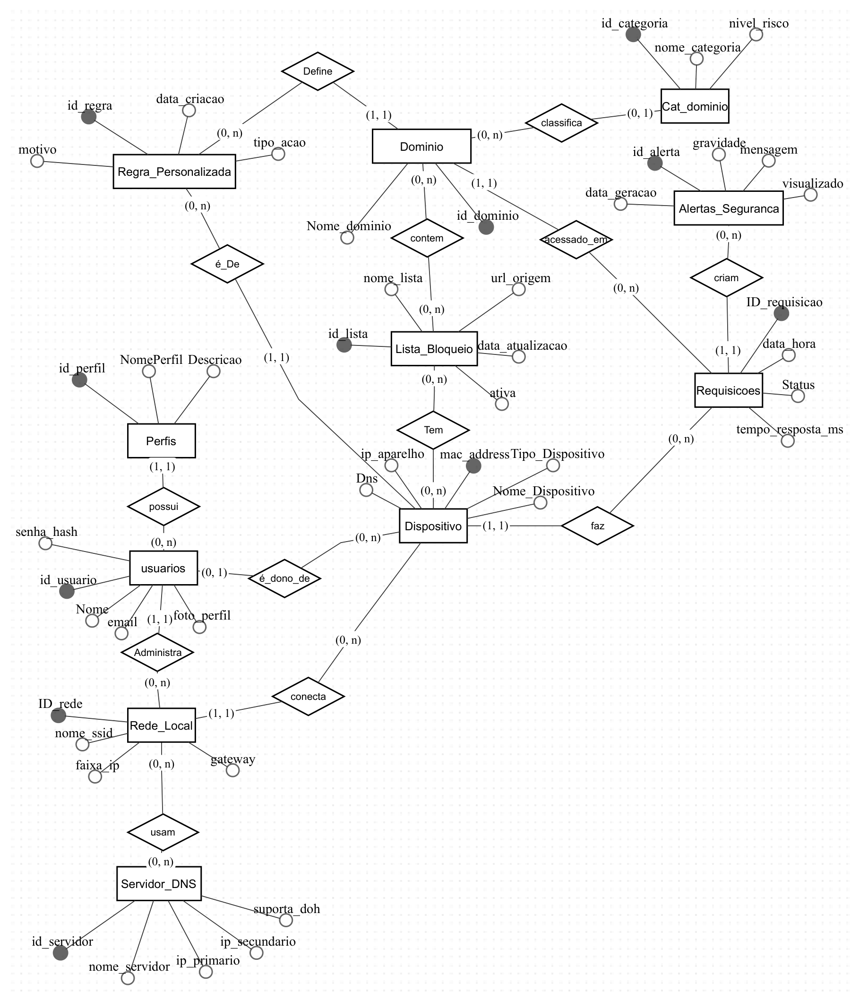
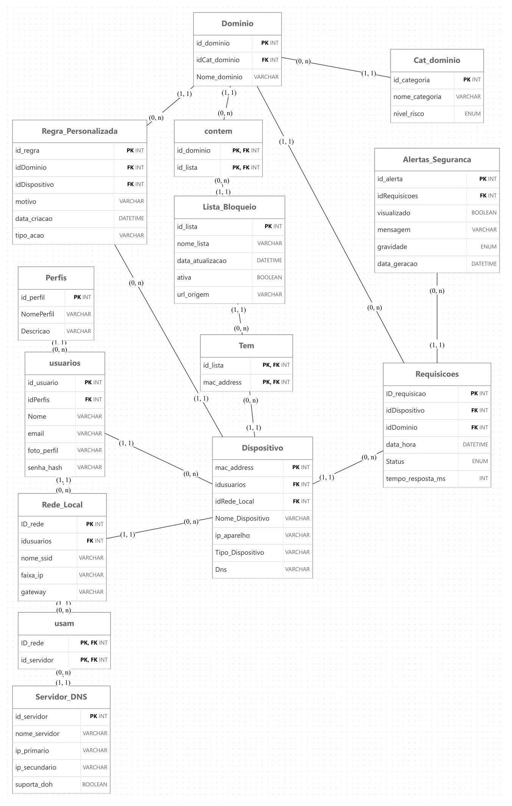

<b>Universidade de Brasília — Instituto de Ciências Exatas</b> 
<b>Departamento de Ciência da Computação — Banco de Dados — 2026/2</b>

<h1>Sistema de Monitoramento de Rede Doméstica e Bloqueio de Anúncios via DNS</h1>
<h3>Projeto de Banco de Dados — Entrega 1</h3>

<b>Repositório:</b> <a href="https://github.com/Geovanne-JR/Projeto-BD-2026-2">https://github.com/Geovanne-JR/Projeto-BD-2026-2</a>

<b>Integrantes:</b> 
Felipe Brasil Vieira — 252009143 
Gabriel de Medeiros Matos — 242001491 
Geovanne Junio Menezes Lima — 252001154 
Washington Matheus Almeida Xavier — 252024622

---

## 1. Introdução

Hoje uma casa tem muitos aparelhos conectados à internet: celulares, notebooks, Smart TVs, consoles e dispositivos IoT. Antes de acessar qualquer site, cada um desses aparelhos faz uma **consulta DNS** para descobrir o endereço IP do domínio. Boa parte dessas consultas não vem do usuário. Ela vem de **anúncios, rastreadores e telemetria** embutidos em aplicativos e páginas, e às vezes de **domínios maliciosos**.

Inspirado no **Pi-hole**, este projeto propõe um sistema que funciona como servidor DNS da rede doméstica. Ele **bloqueia domínios indesejados** para todos os dispositivos ao mesmo tempo, comparando cada consulta com listas de bloqueio e regras personalizadas. Também **registra o histórico** das requisições, mostrando qual aparelho acessou qual domínio e quando, e **gera alertas** quando um domínio de alto risco é consultado.

O banco de dados, implementado em **PostgreSQL**, guarda os usuários e perfis de acesso, as redes locais e seus servidores DNS, os dispositivos conectados, os domínios e suas categorias, as listas de bloqueio, as regras personalizadas por dispositivo, o histórico de requisições DNS e os alertas de segurança. O modelo tem **11 entidades** e **3 relacionamentos N:N**, totalizando 14 tabelas. A aplicação CRUD, com interface gráfica em **Java (JavaFX + JDBC)**, será desenvolvida na entrega final.

## 2. Diagrama Entidade-Relacionamento

<!-- Exporte o DER do brModelo como PNG para esta pasta com o nome der.png -->

## 3. Modelo Relacional

<!-- Exporte o modelo relacional do brModelo como PNG para esta pasta com o nome modelo_relacional.png -->

> Os tipos do diagrama são os tipos genéricos disponíveis no brModelo Web. Os tipos reais do PostgreSQL (ex.: `BYTEA`, `INET`, `TIMESTAMP`) estão no script `sql/schema.sql` do repositório.

## 4. Indicação do Uso de IA

Conforme as regras da disciplina, informamos onde e com qual objetivo usamos ferramentas de Inteligência Artificial nesta etapa. **O tema, as entidades, os atributos e os diagramas (feitos no brModelo) são do grupo.** A IA foi usada apenas como apoio pontual, e todo o material foi revisado pelos integrantes.

| Onde | Objetivo |
|---|---|
| **Estrutura do repositório** | Sugerir a organização das pastas do projeto no GitHub (`docs/`, `sql/`, `src/`) e o `README.md`. |
| **Cardinalidades do DER** | Revisar o diagrama feito pelo grupo e apontar ajustes nas cardinalidades `(mín, máx)` dos relacionamentos, que no rascunho estavam quase todas como (0,n). Também ajudou a entender a notação usada pelo brModelo e a posição correta das chaves estrangeiras no modelo relacional. |
| **Texto da introdução** | Apoio na redação da introdução deste documento. |
