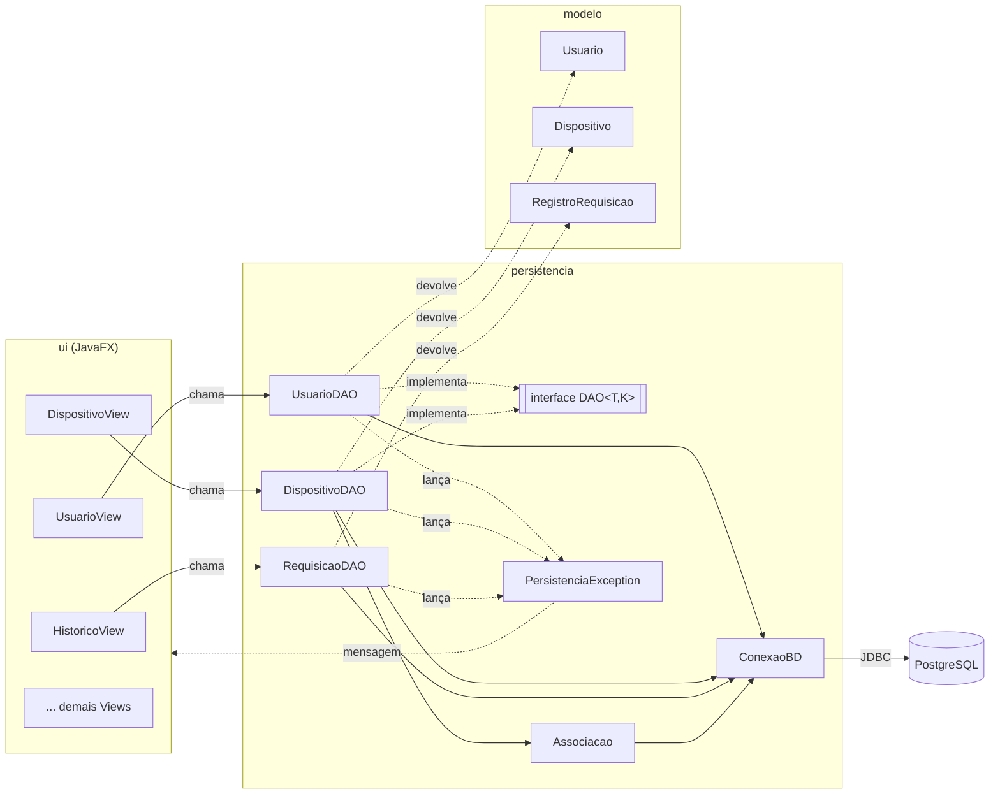
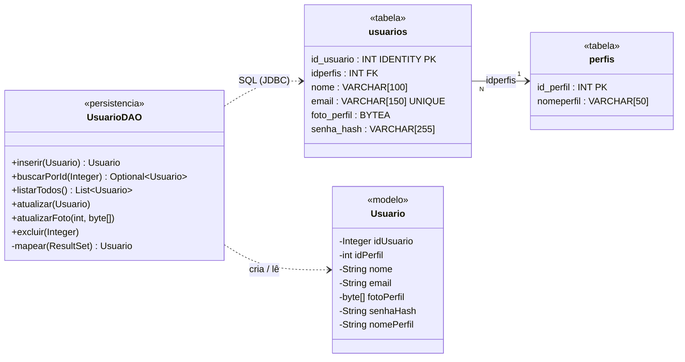

<div align="center">

**Repositório GitHub:** <https://github.com/Geovanne-JR/Projeto-BD-2026-2>

**Universidade de Brasília — Instituto de Ciências Exatas**
**Departamento de Ciência da Computação — Disciplina: Banco de Dados — 2026/2**

# Sistema de Monitoramento de Rede Doméstica e Bloqueio de Anúncios via DNS

### Entrega Final — Aplicação CRUD, Camada de Persistência e Objetos do Banco

**Integrantes:** _(preencher: Nome — Matrícula)_

**SGBD:** PostgreSQL  **Aplicação:** Java 21 + JavaFX (interface) + JDBC (persistência)

</div>

---

## Sumário

1. Visão geral da aplicação
2. Camada de persistência
3. Camada de mapeamento de uma tabela
4. CRUD e funcionalidades com tabelas relacionadas
5. View, Procedure e Triggers
6. Dado binário e gerador automático de chave
7. Carga de dados
8. Como executar
9. Indicação do Uso de IA

---

## 1. Visão geral da aplicação

A aplicação é um programa desktop em **Java + JavaFX** que permite a um usuário leigo administrar a rede doméstica: cadastrar usuários, redes, dispositivos, servidores DNS, listas de bloqueio, domínios e regras, além de acompanhar o histórico de requisições DNS e os alertas de segurança.

A janela principal tem uma **aba por cadastro**. As telas de cadastro seguem o mesmo padrão: **tabela com os registros à esquerda** e **formulário à direita**, com os botões **Novo**, **Salvar** e **Excluir**. Para editar, basta clicar em uma linha da tabela. Erros do banco (chave duplicada, violação de integridade referencial, endereço IP inválido etc.) aparecem em caixas de mensagem em português.

| Aba | Tabelas envolvidas | Operações |
|---|---|---|
| Dispositivos | `dispositivo`, `usuarios`, `rede_local`, `lista_bloqueio`, `tem` | CRUD + listas aplicadas ao dispositivo |
| Redes | `rede_local`, `usuarios`, `servidor_dns`, `usam` | CRUD + servidores DNS da rede |
| Servidores DNS | `servidor_dns` | CRUD |
| Listas de bloqueio | `lista_bloqueio`, `dominio`, `contem` | CRUD + domínios da lista |
| Domínios | `dominio`, `cat_dominio` | CRUD |
| Categorias | `cat_dominio` | CRUD |
| Regras | `regra_personalizada`, `dispositivo`, `dominio` | CRUD |
| Histórico DNS | **view** `vw_historico_requisicoes`; **procedure** `registrar_requisicao` | Consulta + simular requisição |
| Alertas | `alertas_seguranca`, `requisicoes`, `dispositivo`, `dominio` | Consulta, marcar como visto, excluir |
| Usuários | `usuarios`, `perfis` | CRUD + upload de foto (BYTEA) |
| Perfis | `perfis` | CRUD |

## 2. Camada de persistência

O código é organizado em camadas. **A interface nunca escreve SQL**: ela chama métodos dos DAOs (*Data Access Objects*), que devolvem objetos do modelo.

```
src/main/java/br/unb/bd/pihole/
├── App.java, Launcher.java   janela principal e ponto de entrada
├── ui/                       telas JavaFX (uma View por aba)
├── persistencia/             ConexaoBD, interface DAO, um DAO por tabela
├── modelo/                   classes que espelham as tabelas
└── util/                     hash de senha e formatação
```

| Pacote | Responsabilidade |
|---|---|
| `ui` | Monta as telas, lê os campos, valida o preenchimento e mostra mensagens. `CadastroView` é a base comum das telas de cadastro. |
| `persistencia` | Único pacote que conhece SQL e JDBC. `ConexaoBD` abre as conexões a partir do arquivo `db.properties`; a interface `DAO<T, K>` define o contrato do CRUD (`inserir`, `buscarPorId`, `listarTodos`, `atualizar`, `excluir`); `PersistenciaException` converte os códigos SQLState do PostgreSQL em mensagens amigáveis. |
| `modelo` | Uma classe (ou *record*) por tabela, com um atributo por coluna. São os objetos que trafegam entre a interface e a persistência. |

Decisões da camada de persistência:

- **Sempre `PreparedStatement` com parâmetros `?`**, o que evita SQL injection e trata aspas e caracteres especiais.
- **Uma conexão por operação**, aberta e fechada com *try-with-resources*.
- **Chaves geradas pelo banco** são lidas com `INSERT ... RETURNING`.
- **Tipos específicos do PostgreSQL** (`INET`, `CIDR`, `MACADDR` e os ENUMs) são enviados como texto e convertidos no próprio SQL (`?::inet`, `?::macaddr`, `?::nivel_risco_enum`). Assim, a validação do formato fica com o banco.
- **Tabelas associativas** (`usam`, `contem`, `tem`) são gravadas pela classe `Associacao` numa **transação** (`setAutoCommit(false)` → `commit` / `rollback`).

### 2.1 Diagrama: como a interface acessa a persistência



### 2.2 Exemplo de fluxo: salvar um dispositivo

```mermaid
sequenceDiagram
    actor U as Usuário
    participant V as DispositivoView
    participant D as DispositivoDAO
    participant A as Associacao (tem)
    participant BD as PostgreSQL

    U->>V: preenche o formulário e clica em Salvar
    V->>V: valida campos obrigatórios
    V->>D: inserir(dispositivo)
    D->>BD: INSERT INTO dispositivo ... VALUES (?::macaddr, ...)
    BD-->>D: OK (ou erro 23505 / 22P02)
    V->>D: definirListas(mac, [1, 5])
    D->>A: definir(mac, [1, 5])
    A->>BD: BEGIN; DELETE ...; INSERT ... ON CONFLICT DO NOTHING; COMMIT
    V->>D: listarTodos()
    D->>BD: SELECT ... JOIN usuarios ... JOIN rede_local
    D-->>V: List<Dispositivo>
    V-->>U: tabela atualizada
```

## 3. Camada de mapeamento de uma tabela

Mapeamento da tabela **`usuarios`** para a classe **`modelo.Usuario`**, feito em `persistencia.UsuarioDAO`:



| Coluna (`usuarios`) | Tipo SQL | Atributo (`Usuario`) | Tipo Java | Leitura (`ResultSet`) | Escrita (`PreparedStatement`) |
|---|---|---|---|---|---|
| `id_usuario` | `INT IDENTITY` | `idUsuario` | `Integer` | `getInt` | gerado pelo banco (`RETURNING id_usuario`) |
| `idperfis` | `INT` (FK) | `idPerfil` | `int` | `getInt` | `setInt` |
| `nome` | `VARCHAR(100)` | `nome` | `String` | `getString` | `setString` |
| `email` | `VARCHAR(150)` | `email` | `String` | `getString` | `setString` |
| `foto_perfil` | `BYTEA` | `fotoPerfil` | `byte[]` | `getBytes` | `setBytes` |
| `senha_hash` | `VARCHAR(255)` | `senhaHash` | `String` | `getString` | `setString` (hash PBKDF2) |
| `perfis.nomeperfil` | via `JOIN` | `nomePerfil` | `String` | `getString` | não é gravado |

`id_usuario` usa `Integer` (e não `int`) porque o valor é `null` enquanto o objeto ainda não foi inserido. A listagem não traz a coluna `foto_perfil`, para não transferir imagens que a tabela não exibe. A foto só é lida em `buscarPorId`, quando o usuário seleciona uma linha.

## 4. CRUD e funcionalidades com tabelas relacionadas

Todas as 11 entidades podem ser consultadas pela aplicação, e 9 delas têm CRUD completo. As requisições DNS são geradas pelo tráfego da rede, portanto são **registradas pela procedure** e só consultadas. Os alertas são **gerados pelo trigger**, e a aplicação permite consultá-los, marcá-los como vistos e excluí-los.

**Funcionalidades que envolvem duas ou mais tabelas relacionadas:**

1. **Listas de bloqueio de um dispositivo** (aba Dispositivos): o formulário do dispositivo mostra caixas de seleção com todas as listas de `lista_bloqueio`, e marcá-las grava a tabela associativa `tem`. O dono vem de `usuarios` e a rede vem de `rede_local`, ambos por ComboBox. Ao todo são 5 tabelas.
2. **Domínios de uma lista** (aba Listas de bloqueio): grava `contem`. O trigger `trg_contem_atualiza_lista` atualiza a data da lista.
3. **Servidores DNS de uma rede** (aba Redes): grava `usam`.
4. **Regras personalizadas**: ligam um `dispositivo` a um `dominio`. A constraint `UNIQUE (iddominio, iddispositivo)` impede duas regras para o mesmo par.

**Integridade referencial tratada na interface:**

| Situação | Restrição do banco | Mensagem exibida |
|---|---|---|
| Excluir um perfil em uso | FK `fk_usuarios_perfis` (erro 23503) | "Operação não permitida: o registro está ligado a outros dados..." |
| Excluir uma rede com dispositivos | FK `fk_dispositivo_rede` (23503) | idem |
| Excluir um usuário dono de dispositivos | `ON DELETE SET NULL` | os dispositivos ficam "(sem dono)" |
| Excluir uma lista de bloqueio | `ON DELETE CASCADE` em `contem` e `tem` | os vínculos são removidos junto |
| Cadastrar e-mail ou domínio repetido | `UNIQUE` (23505) | "Já existe um registro com esse valor..." |
| Digitar IP ou MAC inválido | tipos `INET` / `MACADDR` (22P02) | "Formato inválido (verifique IP, MAC ou números)." |

## 5. View, Procedure e Triggers

Todos estão em [`sql/objetos.sql`](../../sql/objetos.sql) e são **usados pela aplicação**.

### 5.1 View `vw_historico_requisicoes`

Junta `requisicoes`, `dispositivo`, `usuarios`, `dominio` e `cat_dominio`, trocando chaves por nomes legíveis. A aba **Histórico DNS** lê o histórico só por ela (`RequisicaoDAO.listarHistorico`).

```sql
CREATE OR REPLACE VIEW vw_historico_requisicoes AS
SELECT r.id_requisicao, r.data_hora, r.iddispositivo AS mac_address, d.nome_dispositivo,
       u.nome AS dono, dm.nome_dominio, c.nome_categoria, c.nivel_risco,
       r.status, r.tempo_resposta_ms
FROM requisicoes r
JOIN dispositivo d      ON d.mac_address  = r.iddispositivo
LEFT JOIN usuarios u    ON u.id_usuario   = d.idusuarios
JOIN dominio dm         ON dm.id_dominio  = r.iddominio
LEFT JOIN cat_dominio c ON c.id_categoria = dm.idcat_dominio;
```

### 5.2 Procedure `registrar_requisicao(mac, id_dominio, tempo_ms, data_hora)`

Registra uma requisição DNS **decidindo o status**, como o Pi-hole faria:

1. se existe uma **regra personalizada** do dispositivo para o domínio, ela decide (`bloquear` → *bloqueada*, `liberar` → *permitida*);
2. sem regra, o domínio é **bloqueado** se estiver em alguma **lista ativa** associada ao dispositivo (`tem` → `lista_bloqueio` → `contem`);
3. se a mesma consulta foi permitida há menos de 5 minutos, a resposta vem do **cache**.

Na aplicação, o botão **"Simular requisição"** da aba Histórico DNS executa `CALL registrar_requisicao(...)`. A carga de dados também usa a procedure para gerar o histórico.

### 5.3 Trigger `trg_alerta_requisicao` (AFTER INSERT ON requisicoes)

Quando uma requisição é **bloqueada** e o domínio é de categoria com risco **alto** ou **crítico**, insere automaticamente um registro em `alertas_seguranca`. A gravidade é derivada do nível de risco, e a mensagem cita o dispositivo, o domínio e a categoria. Para demonstrar, simule uma requisição de qualquer dispositivo para `malware-exemplo.test` e abra a aba **Alertas**.

### 5.4 Trigger `trg_contem_atualiza_lista` (AFTER INSERT OR DELETE ON contem)

Sempre que um domínio entra ou sai de uma lista, atualiza `lista_bloqueio.data_atualizacao`. O resultado aparece na coluna "Atualizada em" da aba Listas de bloqueio.

## 6. Dado binário e gerador automático de chave

- **Dado binário:** `usuarios.foto_perfil` é `BYTEA`. Na aba Usuários, o botão **"Escolher foto..."** abre um seletor de arquivos (PNG, JPG ou GIF de até 2 MB). Os bytes são gravados com `PreparedStatement.setBytes` e lidos de volta com `ResultSet.getBytes`, e a imagem é exibida no formulário.
- **Gerador automático de chave:** 10 tabelas usam `INT GENERATED ALWAYS AS IDENTITY` (por exemplo, `usuarios.id_usuario` e `dominio.id_dominio`). O ID gerado volta para a aplicação pelo `RETURNING`.
- **Senhas:** `senha_hash` guarda um hash PBKDF2-SHA256 com sal aleatório (classe `util.Senha`). A senha em texto nunca é gravada.

## 7. Carga de dados

O script [`sql/dados.sql`](../../sql/dados.sql) popula todas as tabelas:

| Tabela | Registros | Tabela | Registros |
|---|---|---|---|
| `perfis` | 10 | `lista_bloqueio` | 10 |
| `usuarios` | 10 | `regra_personalizada` | 10 |
| `rede_local` | 10 | `requisicoes` | 36 (via procedure) |
| `servidor_dns` | 10 | `alertas_seguranca` | gerados pelo trigger |
| `dispositivo` | 12 | `usam` | 15 |
| `cat_dominio` | 10 | `contem` | 41 |
| `dominio` | 21 | `tem` | 25 |

Os domínios maliciosos usam o sufixo reservado `.test`, portanto são fictícios. Todos os usuários de exemplo têm a senha `senha123`.

## 8. Como executar

1. Criar o banco e rodar o script completo:
   ```bash
   createdb -U postgres pihole_bd
   psql -U postgres -d pihole_bd -f sql/criar_banco.sql
   ```
   O script `criar_banco.sql` executa, em ordem, `schema.sql` (tabelas), `objetos.sql` (view, procedure e triggers) e `dados.sql` (carga).
2. Copiar `src/main/resources/db.properties.example` para `db.properties` e ajustar usuário e senha do PostgreSQL.
3. Executar `mvn javafx:run` (ou a classe `br.unb.bd.pihole.Launcher` pela IDE). Requer JDK 21 ou superior.

## 9. Indicação do Uso de IA

Conforme as regras da disciplina, informamos onde e com qual objetivo usamos ferramentas de IA nesta etapa. A IA foi usada como apoio, e todo o material foi revisado, testado e validado pelos integrantes.

| Ferramenta | Onde foi utilizada | Objetivo |
|---|---|---|
| **Claude Code** (Anthropic) | Arquitetura da aplicação | Propor a divisão em camadas (`ui`, `persistencia`, `modelo`) e compará-la com a arquitetura usada pelo grupo na disciplina de TP1. |
| **Claude Code** (Anthropic) | Código Java (`src/main/java`) | Gerar as classes de modelo, os DAOs com JDBC, a tradução de erros SQLState e as telas JavaFX. |
| **Claude Code** (Anthropic) | `sql/objetos.sql` | Gerar a view, a procedure e os triggers a partir das regras de negócio definidas pelo grupo. |
| **Claude Code** (Anthropic) | `sql/dados.sql` | Gerar a carga de dados de exemplo, coerente com as listas, regras e cenários de alerta. |
| **Claude Code** (Anthropic) | Esta documentação | Redigir o rascunho deste documento e os diagramas Mermaid. |

**Responsabilidade do grupo:** _(preencher: o que o grupo revisou, testou e alterou — por exemplo, execução dos scripts no PostgreSQL, testes de cada tela, ajustes de layout e textos.)_
